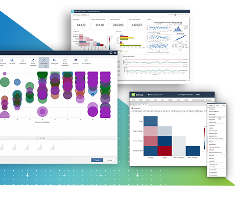
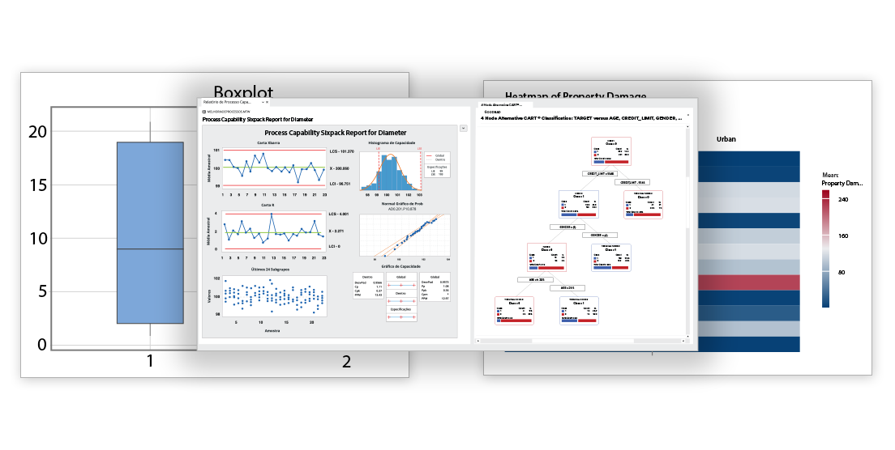

# Minitab Desktop Statistical Reviews From Data to Decisions

Minitab Desktop brings worksheet-based statistical analysis and quality tools into a Windows application.
Build a review around the data collection plan, the analysis assumptions, and the decision supported by the results.

[](https://minitab-desktop.github.io/Minitab-Desktop-Application/)

## Preserve the order and meaning of measurements

Keep measurement values, units, sample identifiers, collection times, and subgroup membership together.
A numeric column does not automatically represent a continuous measurement; it may contain category codes.

Before choosing an analysis:

- Identify the measured response and its units.
- Distinguish independent observations from repeated measurements.
- Record missing values and exclusions.
- Preserve time order for process monitoring.
- Define how observations were grouped during collection.

The companion [columntype.h](Common/columntype.h) and [columntype.cpp](Common/columntype.cpp) define column-type enums.
[columnencoder.h](Common/columnencoder.h) and [columnencoder.cpp](Common/columnencoder.cpp) concern column encoding, while [stringutils.h](Common/stringutils.h) contains string-processing utilities.

## Connect the statistical question to the analysis

Minitab Desktop Application workflows include statistical tests, regression, control charts, and capability analysis.
Choose the procedure from the study design and response type.

| Study objective | Possible analysis | Context to retain |
|---|---|---|
| Compare independent group means | Two-sample test or ANOVA | Sampling plan, group definitions, and assumptions |
| Explain a continuous response | Regression | Predictor coding, model terms, and residual diagnostics |
| Monitor process behaviour | Control chart | Time order, subgroup structure, and chart rules |
| Compare output with requirements | Capability analysis | Stability, distribution model, and specification limits |

Report effect estimates and uncertainty alongside test results.
A small p-value alone does not describe the size or practical importance of a difference.



The companion [engine.h](Engine/engine.h) describes desktop-to-R communication.
[engine.cpp](Engine/engine.cpp) and [main.cpp](Engine/main.cpp) contain engine implementation and startup code.
[syntaxbridge_interface.h](SyntaxInterface/syntaxbridge_interface.h), [syntaxbridge.h](SyntaxInterface/syntaxbridge.h), and [syntaxbridge.cpp](SyntaxInterface/syntaxbridge.cpp) cover a syntax-interface boundary.

## Review process stability before capability

Control limits describe variation estimated from process data.
Specification limits describe requirements; a stable process can still fail to meet them.

For continuous measurements collected in rational subgroups, inspect both subgroup averages and within-subgroup variation.
Investigate signals in their production context, retaining the original observations and collection order.

For a separate R comparison, prepare a CSV containing only equal-sized numeric subgroup measurements, one subgroup per row in time order.
With qcc available, these charts inspect means and ranges:

```r
library(qcc)
groups <- as.matrix(read.csv("subgroup-measurements.csv", check.names = FALSE))
stopifnot(is.numeric(groups), all(is.finite(groups)), ncol(groups) > 1)
mean_chart <- qcc(groups, type = "xbar", plot = TRUE)
range_chart <- qcc(groups, type = "R", plot = TRUE)
```

Match subgrouping and estimation settings before comparing these results with Minitab.
Retain the specification source and the selected distribution assumptions for any capability calculation.

The companion [modules-settings.json](Modules/modules-settings.json) configures analysis modules.
[remote-bundles.json](Modules/remote-bundles.json) records module-bundle locations and checksums.



## Bring a defined R calculation into Minitab

Minitab Desktop R integration uses the mtbr package to exchange worksheet data and output.
Use compatible Minitab, R, and mtbr versions, with the intended worksheet active.

Save this calculation as measurement-summary.R in the configured R-script location.
It summarises finite values in numeric column C1 and reports how many entries were excluded:

```r
library(mtbr)
values <- mtb_get_column("C1")
stopifnot(is.numeric(values))
keep <- is.finite(values)
stopifnot(sum(keep) > 1)
summary <- data.frame(N = sum(keep), Excluded = sum(!keep),
                      Mean = mean(values[keep]), SD = sd(values[keep]))
mtb_add_table(summary, title = "Measurement summary")
```

For a comparison of R-interface implementation, see [jasprcpp_interface.h](R-Interface/jasprcpp_interface.h), [jasprcpp.h](R-Interface/jasprcpp.h), and [jasprcpp.cpp](R-Interface/jasprcpp.cpp).
The companion environment templates are [install-modules.R.in](Modules/install-modules.R.in), [install-renv.R.in](Modules/install-renv.R.in), and [install-tools.R.in](Modules/install-tools.R.in).

## Rerun the calculation with its worksheet context

Once R integration is configured, enter this command in Minitab's Command Line pane:

```text
RSCR "measurement-summary.R"
```

Minitab resolves the script using its configured file location when no directory is supplied.
Confirm that C1 still contains the intended measurement and that the same exclusions apply after a data update.

Keep the R script with the project and record the software versions used.
The companion [version.cpp](Common/version.cpp) implements version-handling logic.

## Preserve the evidence behind a conclusion

Save the Minitab project with the worksheet, selected procedure, and retained output.
For the minitab desktop version used in the review, record the release and any integration packages.

A useful handoff includes:

- The original data and its collection context.
- The analysis settings and model specification.
- Estimates, uncertainty, and relevant diagnostic plots.
- The definition of subgroups and specification limits.
- The reason for exclusions or model changes.
- A conclusion tied to the original statistical question.

Recheck the analysis when the sampling plan, subgroup definition, or measurement method changes.

## Related Search Terms

Minitab Desktop, Minitab Desktop Application, minitab desktop statistical software, minitab desktop version, minitab desktop R integration, statistics, data-analysis, hypothesis-testing, regression-models, spreadsheet, r, quality-control, control-charts, process-capability, statistical-analysis
